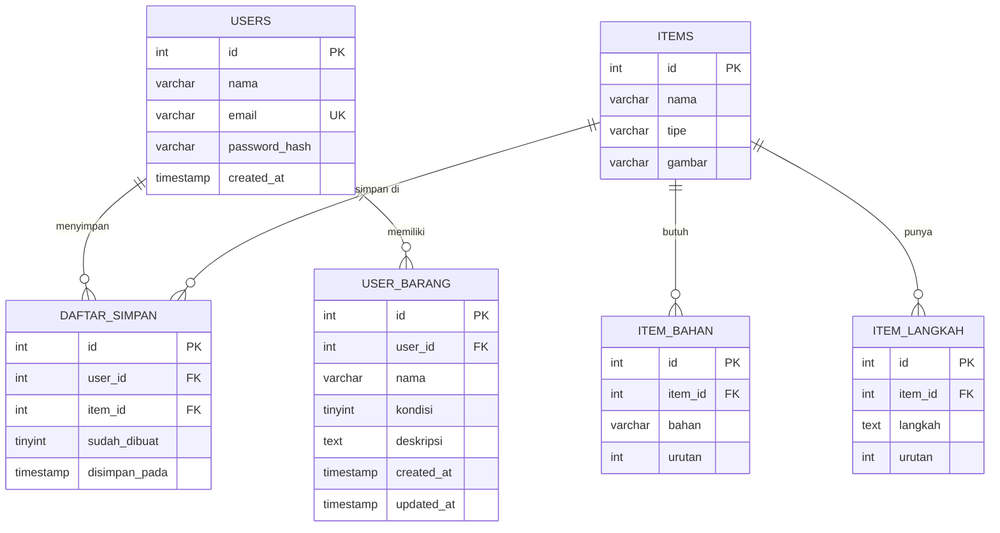

# ERD dan Skema Tabel RE:LOOP

Sumber kebenaran skema ada di `database.sql`. Dokumen ini hanya merangkumnya.

## ERD

`DAFTAR_SIMPAN` adalah tabel penghubung many-to-many antara `USERS` dan `ITEMS`:
satu pengguna bisa menyimpan banyak item, dan satu item bisa disimpan banyak
pengguna. Pasangan `(user_id, item_id)` bersifat unik, jadi item yang sama tidak
bisa disimpan dua kali oleh pengguna yang sama.

Mode guest tidak punya tabel sendiri. Guest adalah pengunjung tanpa sesi login,
sehingga tidak punya baris di `users` maupun `daftar_simpan`.

## Skema tabel

### users (baru)

| Kolom | Tipe | Keterangan |
|---|---|---|
| id | INT, PK, AUTO_INCREMENT | |
| nama | VARCHAR(100), NOT NULL | nama tampilan |
| email | VARCHAR(150), NOT NULL, UNIQUE | disimpan huruf kecil |
| password_hash | VARCHAR(255), NOT NULL | hasil `password_hash()` PHP, bukan password asli |
| created_at | TIMESTAMP, NOT NULL, default sekarang | |

### daftar_simpan (baru)

| Kolom | Tipe | Keterangan |
|---|---|---|
| id | INT, PK, AUTO_INCREMENT | |
| user_id | INT, NOT NULL, FK ke users(id) | ON DELETE CASCADE |
| item_id | INT, NOT NULL, FK ke items(id) | ON DELETE CASCADE |
| sudah_dibuat | TINYINT(1), NOT NULL, default 0 | 0 = belum, 1 = sudah dibuat |
| disimpan_pada | TIMESTAMP, NOT NULL, default sekarang | |

Constraint: `UNIQUE (user_id, item_id)`.

### items, item_bahan, item_langkah (sudah ada, tidak diubah)

| Tabel | Kolom |
|---|---|
| items | id (PK), nama, tipe, gambar |
| item_bahan | id (PK), item_id (FK ke items), bahan, urutan |
| item_langkah | id (PK), item_id (FK ke items), langkah, urutan |

## Pemetaan CRUD daftar simpan

Semua endpoint ada di folder `api/` dan butuh login (tanpa login: HTTP 401).
Request yang mengubah data harus dikirim sebagai JSON (`Content-Type: application/json`).

| Operasi | Fitur | Endpoint | Body JSON |
|---|---|---|---|
| Create | simpan ide/tutorial | `POST api/saved.php` | `{"item_id": 7}` |
| Read | lihat daftar simpan | `GET api/saved.php` | - |
| Update | tandai sudah/belum dibuat | `PATCH api/saved.php` | `{"item_id": 7, "sudah_dibuat": true}` |
| Delete | hapus dari daftar simpan | `DELETE api/saved.php` | `{"item_id": 7}` |

Endpoint akun:

| Endpoint | Fungsi | Body JSON |
|---|---|---|
| `POST api/register.php` | buat akun dan langsung login | `{"nama", "email", "password"}` (password 8-72 karakter) |
| `POST api/login.php` | login | `{"email", "password"}` |
| `POST api/logout.php` | logout | `{}` |
| `GET api/me.php` | cek status login (`loggedIn: false` berarti guest) | - |

### user_barang (tambahan CRUD inventaris)

| Kolom | Tipe | Keterangan |
|---|---|---|
| id | INT, PK, AUTO_INCREMENT | ID barang |
| user_id | INT, FK ke users(id) | pemilik data, ON DELETE CASCADE |
| nama | VARCHAR(120), NOT NULL | nama barang |
| kondisi | TINYINT UNSIGNED, NOT NULL | rentang 1–10, dibatasi CHECK |
| deskripsi | TEXT, NULL | deskripsi opsional |
| created_at | TIMESTAMP | waktu dibuat |
| updated_at | TIMESTAMP | otomatis berubah saat UPDATE |

Index komposit `(user_id, created_at)` mempercepat daftar inventaris per pengguna.
Setiap operasi API memfilter `user_id` dari sesi login sehingga pengguna tidak dapat
membaca, mengubah, atau menghapus inventaris milik akun lain.

## Pemetaan CRUD inventaris barang

Semua operasi memerlukan login dan memakai JSON (`Content-Type: application/json`)
untuk operasi yang mengubah data.

| Operasi | Endpoint | Contoh body |
|---|---|---|
| Create | `POST api/user-items.php` | `{"nama":"Botol bekas","kondisi":6,"deskripsi":"Botol plastik 1 liter"}` |
| Read | `GET api/user-items.php` | – |
| Update | `PATCH api/user-items.php` | `{"id":1,"nama":"Botol kaca","kondisi":8}` |
| Delete | `DELETE api/user-items.php` | `{"id":1}` |

Contoh status: `201` berhasil membuat, `200` berhasil membaca/mengubah/menghapus,
`400` validasi gagal, `401` belum login, dan `404` data tidak ditemukan atau bukan milik pengguna.

## Materi database yang bisa dipresentasikan

- **PK dan AUTO_INCREMENT:** identitas unik pada setiap tabel.
- **FK dan ON DELETE CASCADE:** menjaga integritas referensial; akun yang dihapus akan menghapus inventaris dan daftar simpannya.
- **Relasi:** `users` ke `user_barang` adalah one-to-many; `users` ke `items` melalui `daftar_simpan` adalah many-to-many.
- **Constraint:** email unik, pasangan pengguna-item unik, serta kondisi barang 1–10.
- **Prepared statement:** input API dikirim sebagai parameter PDO untuk mengurangi risiko SQL injection.
- **Agregasi/query lanjutan (opsional saat demo):** jumlah barang per pengguna dapat dihitung dengan `SELECT user_id, COUNT(*) FROM user_barang GROUP BY user_id`.
